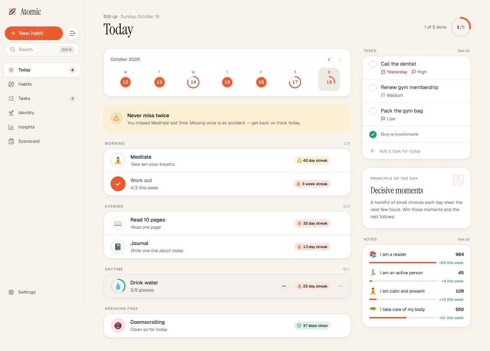
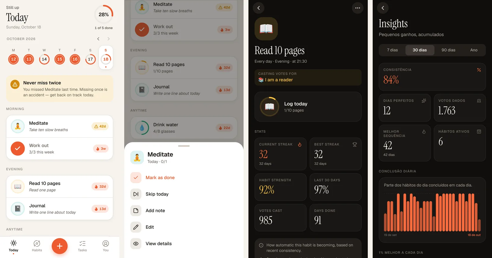
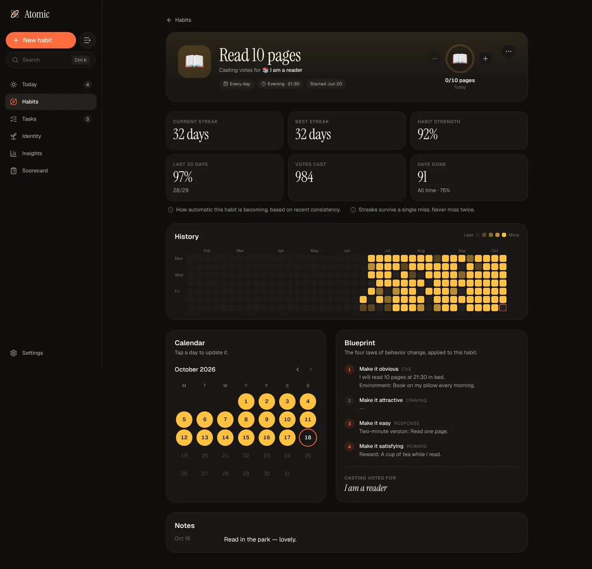
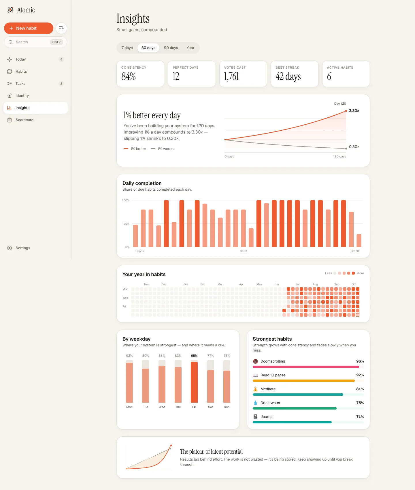

<p align="center">
  
</p>

<h1 align="center">Atomic</h1>

<p align="center"><strong>Tiny habits. Remarkable results.</strong><br/>
A local-first habit and task app built on the four laws of behavior change —
for the web, the desktop and your phone.</p>

<p align="center">
  <a href="https://github.com/andeen171/atomic-habits/releases/tag/android-preview">Android APK</a> ·
  <a href="https://github.com/andeen171/atomic-habits/releases/tag/desktop-preview">Desktop builds</a> ·
  <a href="https://atomic-habits-docs.vercel.app">Docs</a>
</p>





## Why Atomic

Atomic is inspired by James Clear's *Atomic Habits* (not affiliated with the author). Instead of a
generic checklist, the book's ideas are the product:

- **Identity first.** Every completion is a *vote* for who you are becoming ("I am a reader").
  Identities show their votes and weekly momentum.
- **The four laws, built in.** The habit editor walks through *make it obvious, attractive, easy
  and satisfying* — implementation intentions, habit stacking, temptation bundling, the two-minute
  rule, rewards — or their inversions when you are breaking a bad habit. Each habit gets a readable
  **blueprint**.
- **Never miss twice.** Streaks survive a single miss; Today nudges you right away. Two misses in a
  row start over. Skipped rest days are neutral and weekly habits ("3× a week") count in weeks.
- **Habit strength** (how automatic a habit is becoming), **1% better** compounding, year heatmaps,
  weekday patterns and the **Habits Scorecard**.
- **Tasks** live next to your habits: today, overdue, upcoming and someday.
- **Local-first.** Works offline everywhere, in English and Brazilian Portuguese, light and dark.
  Optional self-hosted sync keeps devices together.

| Habit detail | Insights |
| --- | --- |
|  |  |

## Getting started

Requirements: [Bun](https://bun.sh) 1.4+. Rust is only needed for the desktop app, Android Studio
or Xcode only for local native builds.

```bash
bun install
bun dev:web       # web app → http://localhost:3001
bun dev:native    # Expo dev server (use the dev-client APK or a simulator)
bun dev:server    # optional sync server → http://localhost:3000
```

On first launch choose **Explore with sample data** to see the app with four months of history.

| Script | What it does |
| --- | --- |
| `bun dev` | Run every app in development |
| `bun run build` | Build every app |
| `bun run test` | Core and server test suites |
| `bun check-types` | TypeScript across the monorepo |
| `bun check` | Biome lint + format (writes fixes) |
| `bun run build:artifact` | Single-file web build (`apps/web/dist-artifact/`) |
| `cd apps/web && bun desktop:dev` | Tauri desktop app |
| `cd apps/native && bun android` | Local Android build (needs the Android SDK) |

## Monorepo

```text
apps/
  web/      React 19 + Vite + TanStack Router + Tailwind v4 — web, PWA and the Tauri desktop app
  native/   Expo SDK 57 + Expo Router — Android and iOS
  server/   Bun + Hono + tRPC + Drizzle + Better Auth — optional sync
  docs/     Astro Starlight documentation site
packages/
  core/     @atomic/core — the shared engine every app runs on
assets/brand/  logo and icon sources
docs/          internal docs: design spec, architecture, standards
```

`@atomic/core` holds everything that must behave the same on every platform: the domain model
(Zod), calendar-safe day math, the habit science (streaks, strength, votes, weekly quotas, break
habits), the zustand store with persistence and backups, translations, the book-inspired content,
design tokens, and the sync protocol, engine and HTTP client. The apps are thin native UIs on top
of it. See [docs/design.md](docs/design.md) for the product and design spec and
[docs/monorepo.md](docs/monorepo.md) for the architecture.

## Builds and releases

GitHub Actions (`.github/workflows/`):

- **CI** — Biome, type checks for every workspace, core and server tests, web builds.
- **Android APK** — `expo prebuild` + Gradle. Publishes a rolling
  [`android-preview`](https://github.com/andeen171/atomic-habits/releases/tag/android-preview)
  pre-release with a standalone APK and a development-client APK (arm64, debug-signed).
- **Desktop (Tauri)** — Linux, Windows and macOS bundles on a rolling
  [`desktop-preview`](https://github.com/andeen171/atomic-habits/releases/tag/desktop-preview)
  pre-release.

`apps/native/eas.json` also defines `development`, `preview` and `production` profiles for EAS
Build (`eas build --profile preview --platform android`).

## Sync (optional)

The apps never need an account. To share data between devices, run `apps/server` (Docker image
included) and sign in from **Settings → Sync**. Auth is email + password with bearer tokens;
documents sync with last-write-wins and tombstones. See
[apps/server/README.md](apps/server/README.md).

## License and credits

Inspired by *Atomic Habits* by James Clear. Atomic is an independent project and is not affiliated
with the author or publisher. Fonts: Geist and Instrument Serif (SIL Open Font License).
